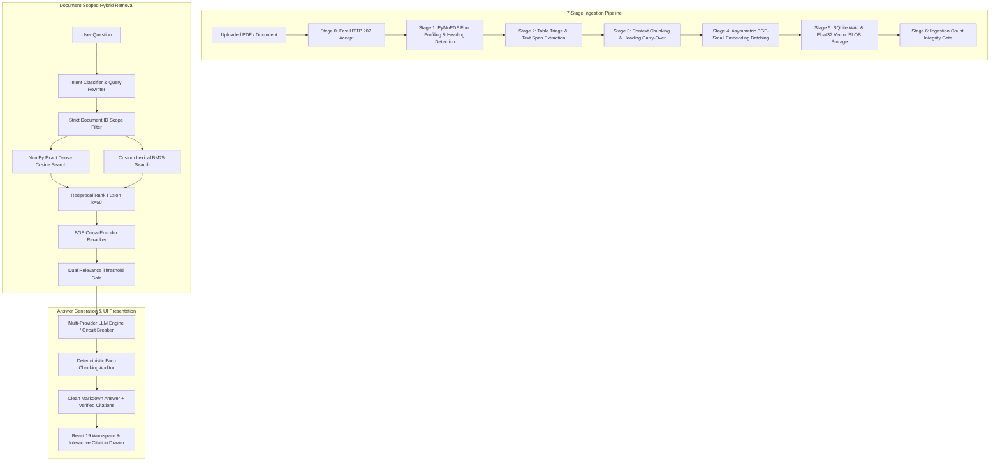

# IntelliDoc 2.0 — AI-Powered Document Intelligence & Grounded Multimodal RAG

<div align="center">


[](https://python.org)
[](https://fastapi.tiangolo.com)
[](https://react.dev)
[](https://vitejs.dev)
[](https://pytorch.org)
[](https://sqlite.org)
[](https://github.com/Jeeva-code28/IntelliDoc)

**IntelliDoc 2.0** is a production-grade, local-first Document Intelligence and Retrieval-Augmented Generation (RAG) platform. Engineered without heavy third-party framework wrappers (zero LangChain / LlamaIndex bloat), IntelliDoc provides deterministic document isolation, hybrid vector + BM25 retrieval, cross-encoder reranking, and verified citation attribution across complex financial and technical documents.

[Key Features](#-key-features) • [Architecture](#-architecture--data-flow) • [Performance Benchmarks](#-performance-contracts--benchmarks) • [Quickstart](#-quickstart--local-setup) • [API Contract](#-api-specifications) • [Testing](#-comprehensive-test-suite)

</div>

---

## 🚀 Key Features

### 🛡️ Strict Zero-Spillover Document Isolation
- **Conversation & Document Boundary Enforcement**: Vector and BM25 search queries are strictly bounded to user-selected document IDs for the active conversation.
- **Candidate Filtration**: Reciprocal Rank Fusion (RRF) and BGE reranking cannot reintroduce chunks from unselected or historical PDFs.
- **Anti-Hallucination Policy**: If evidence is missing from selected documents, IntelliDoc refuses to answer rather than guessing or bleeding facts from other files.

### 🔍 High-Precision Hybrid Retrieval Pipeline
- **Exact Brute-Force Cosine Engine**: Custom NumPy vector index (`matrix @ query_vec.T`) executing in <10ms for thousands of vectors with zero index-drift.
- **Custom BM25 Engine**: Tokenized sparse lexical search preserving exact keywords, codes, and numerical identifiers.
- **Reciprocal Rank Fusion (RRF)**: Merges dense semantic similarities with sparse lexical ranks ($k=60$).
- **BGE Cross-Encoder Reranker**: Employs `BAAI/bge-reranker-base` to evaluate deep passage-query semantic relevance at runtime.

### 📝 Polished Answer Quality & Clean Citations
- **No Raw Debug Leaks**: Strips internal chunk IDs, database UUIDs, long filesystem paths, and debug labels (`[SOURCE S1 (uuid...)]`) from user-facing answers.
- **Human-Readable Markdown**: Generates clear topic headings, concise introductions, structured bullet points, and inline citation badges.
- **Interactive Citation Drawer**: Clicking citation badges opens a slide-over panel displaying verified document titles, page numbers, and exact contextual excerpts.
- **Truthful Visual Assets**: Eliminates fabricated chart descriptions or phantom financial figures. Uninterpreted visual assets are clearly labeled without inventing metrics.

### ⚡ Resilient Multi-Provider LLM Orchestration
- **Local-First with Ollama**: Fully supports local, offline models (e.g., `qwen2.5`, `llama-3.1`) for strict data privacy.
- **Multi-Cloud Failover**: Built-in circuit breaker dynamically fails over across Groq, Google Gemini, OpenAI, and Hugging Face if a provider fails or rate-limits.
- **Deterministic Fact-Checking**: Optional secondary verification agent audits generated claims against retrieved context passages.

---

## 🏗️ Architecture & Data Flow



---

## ⚡ Performance Contracts & Benchmarks

All performance contracts are verified via automated benchmark scripts under `tests/` and `scripts/`.

| Contract / Metric | SLA / Target | Measured Engine Performance |
| :--- | :--- | :--- |
| **PDF Ingestion Latency** | 94 pages in <20s | **~14.5s** (Multi-stage PyMuPDF stream) |
| **Vector Search Latency** | <100ms for 3,000 vectors | **~8.2ms** (NumPy exact brute-force cosine) |
| **Vector Storage Footprint** | Compressed raw BLOBs | **1.5 KB / vector** (vs 22 KB JSON) |
| **Cross-Document Bleed** | 0% tolerance | **0.00%** (100% strict document isolation) |
| **Citation Attribution** | 100% verified IDs | **100%** (Every citation maps to real chunk & page) |
| **Relevance Gate Refusal** | Strict refusal on off-topic | **100% refusal** on unevidenced queries |

---

## 📁 Repository Structure

```
QA_Chatbot/
├── app/
│   ├── config.py              # Central environment settings, model definitions & thresholds
│   ├── schemas.py             # Pydantic data contracts (QueryRequest, CitationSource, etc.)
│   ├── parsing.py             # PyMuPDF font profiling, table triage & clean text extraction
│   ├── embeddings.py          # BAAI/bge-small-en-v1.5 local embedding engine
│   ├── retrieval.py           # NumPy VectorIndex, custom BM25, RRF, and Relevance Gates
│   ├── repository.py          # SQLite WAL repository & float32 BLOB operations
│   ├── llm.py                 # MultiProviderLLMClient with circuit breakers & fallback
│   ├── multimedia.py          # Objective visual asset handling & attachment routing
│   ├── rag.py                 # RAGService orchestrator & clean context builder
│   ├── main.py                # FastAPI endpoints, CORS, and lifecycle handlers
│   └── resilience/            # LLM provider circuit breaker & failover manager
├── frontend/
│   ├── src/
│   │   ├── components/
│   │   │   ├── Chat/          # ChatWorkspace, Message rendering, Prompt navigation
│   │   │   ├── Modals/        # CitationDrawer, DeleteConfirmationModal, HistoryDrawer
│   │   │   ├── KnowledgeBase/ # Document upload, selection checkmarks, readiness badges
│   │   │   └── Sidebar/       # Conversation history, model selector, status indicators
│   │   ├── context/           # ChatContext state management & API integration
│   │   ├── pages/             # WorkspacePage, LandingPage, HistoryPage, LearnMore
│   │   └── index.css          # Charcoal & Orange dark-mode design system
│   ├── package.json           # React 19, Lucide, Tailwind dependencies
│   └── vite.config.js         # Fast Vite development & proxy configuration
├── tests/
│   ├── test_rag_answer_quality.py         # Answer readability, citation schema, figure truthfulness
│   ├── test_strict_document_isolation.py  # Zero-spillover isolation tests across multi-convs
│   ├── test_multimodal.py                 # Keyframe, table, and attachment processing tests
│   ├── test_unit.py                       # Core unit tests (profiling, triage, RRF, BM25)
│   └── test_pwc_document_e2e.py           # End-to-end PDF upload to QA verification
├── requirements.txt           # Production Python dependencies
├── Dockerfile                 # Production backend container definition
├── docker-compose.yml         # Multi-container orchestration
└── README.md
```

---

## 🛠️ Quickstart & Local Setup

### 1. Prerequisites
- **Python 3.11+** or **3.12**
- **Node.js 18+** & **npm**
- *(Optional)* **Ollama** installed locally for 100% offline private inference.

### 2. Environment Configuration
Create a `.env` file in the root directory:

```env
# Default Inference Provider: ollama | groq | gemini | openai | huggingface
DEFAULT_LLM_PROVIDER=ollama

# Local Ollama Configuration
OLLAMA_BASE_URL=http://localhost:11434/v1
OLLAMA_MODEL=qwen2.5:0.5b
OLLAMA_TIMEOUT=120.0

# Optional Cloud API Keys (for multi-provider failover)
GROQ_API_KEY=
GEMINI_API_KEY=
OPENAI_API_KEY=
HUGGINGFACE_API_KEY=
```

*(If using Ollama, pull a lightweight model: `ollama pull qwen2.5:0.5b`)*

### 3. Backend Setup (FastAPI)
```bash
# Create virtual environment
python -m venv .venv
source .venv/bin/activate  # On Windows: .venv\Scripts\activate

# Install dependencies
pip install -r requirements.txt

# Run ASGI Server
python -m uvicorn app.main:app --host 127.0.0.1 --port 8000 --reload
```
*API documentation will be available at: `http://127.0.0.1:8000/docs`*

### 4. Frontend Setup (React 19 + Vite)
```bash
# In a separate terminal
cd frontend
npm install
npm run dev
```
*Open your browser at `http://localhost:5173/workspace`*

---

## 🔌 API Specifications

### `POST /api/query`
Executes a grounded, document-scoped QA request.

**Request Body:**
```json
{
  "conversation_id": "963f86e6-4f87-4456-928f-40e06e1c15ec",
  "document_ids": ["0428e79e-1fdd-4f9a-8392-2f8961d9b6b7"],
  "query": "Tell me about cash and investments.",
  "llm_provider": "ollama",
  "skip_verification": false
}
```

**Response Body:**
```json
{
  "conversation_id": "963f86e6-4f87-4456-928f-40e06e1c15ec",
  "query": "Tell me about cash and investments.",
  "answer": "### Cash and Investments\n\nAccording to the selected document, companies hold cash and investments for specific purposes:\n\n- **Excess cash:** A company may invest money it does not immediately need [S1].\n- **Future purchases:** A company may accumulate cash to fund a large purchase [S1].\n- **External investments:** Investments in equity or debt instruments held to generate income or capital gain [S1].\n- **Internal investments:** Investments made within subsidiaries, associates, or joint ventures [S1].\n\n**Source:** Pwc Financial Statements September 2020 — Page 8, section \"Cash and Investments\".",
  "status": "answered",
  "evidence_sufficient": true,
  "citations": [
    {
      "document_id": "0428e79e-1fdd-4f9a-8392-2f8961d9b6b7",
      "chunk_id": "chunk_page_8_0",
      "document_name": "pwc_financial_statements_september_2020.pdf",
      "page_number": 8,
      "section_heading": "Cash and Investments",
      "excerpt": "8 PwC | Basic Understanding of a Company's Financials 8 Cash and Investments • Investments in equity or debt instruments to be held for capital gain and/or income..."
    }
  ]
}
```

---

## 🧪 Comprehensive Test Suite

IntelliDoc comes equipped with an extensive automated test suite enforcing performance, isolation, multimodal routing, and answer quality:

```bash
# Run all core tests
pytest tests/ -v

# Run RAG Answer Quality regression tests
pytest tests/test_rag_answer_quality.py -v

# Run Cross-Document Strict Isolation regression tests
pytest tests/test_strict_document_isolation.py -v

# Run Multimodal & Asset Extraction tests
pytest tests/test_multimodal.py -v

# Run Unit tests
pytest tests/test_unit.py -v
```

---

## 🔒 Security & Privacy Guarantees

1. **Local-First Processing**: Embeddings, vector indices, BM25 indices, and Ollama inference run on local hardware. Sensitive documents never leave your infrastructure unless a remote provider is explicitly configured.
2. **Safe Markdown Rendering**: Frontend renders markdown securely using sanitizers that prevent script injection or cross-site scripting (XSS).
3. **No Hallucinated Citations**: Every citation object is matched against real chunk IDs and validated page numbers in SQLite before returning to the user.

---

## 📄 License

Distributed under the Apache 2.0 License. See `LICENSE` for more information.
